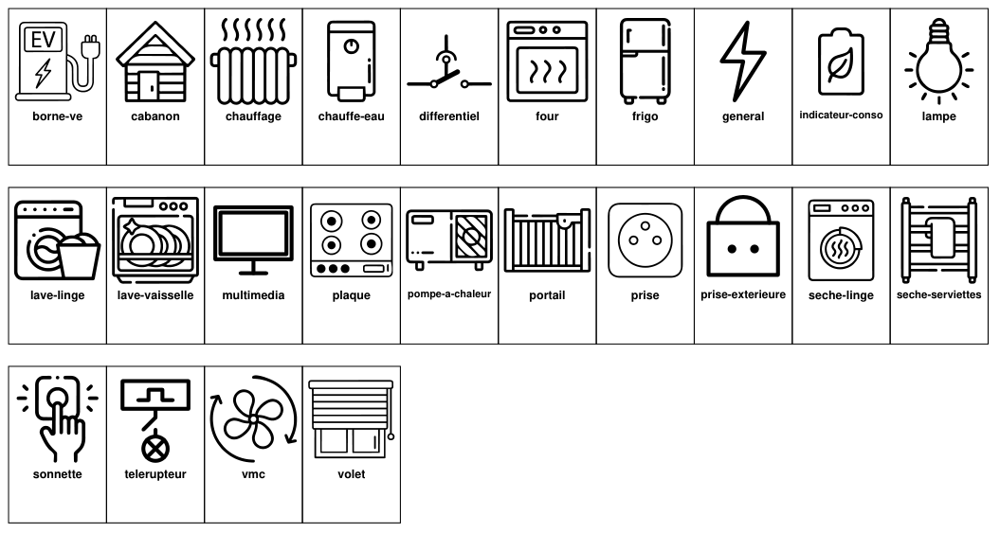

# Étiquettes pour tableau électrique

Générateur de PDF noir et blanc pour identifier les disjoncteurs d'un tableau électrique. Chaque étiquette contient une image et un texte. Le contenu est décrit dans un fichier JSON.

- Python 3.8 ou plus récent, **aucune dépendance externe**.
- La largeur des étiquettes suit celle des modules DIN (17,5 mm par module).

## Sommaire

- [Démarrage rapide](#démarrage-rapide)
- [Fichiers](#fichiers)
- [Structure de la configuration](#structure-de-la-configuration)
  - [Section `tableau`](#section-tableau)
  - [Section `page`](#section-page)
  - [Section `etiquette`](#section-etiquette)
  - [Section `rangees`](#section-rangees)
  - [Étiquettes](#étiquettes)
- [Comportement de la mise en page](#comportement-de-la-mise-en-page)
- [Icônes intégrées](#icônes-intégrées)
  - [Prévisualiser les icônes](#prévisualiser-les-icônes)
- [Ajouter une icône personnalisée](#ajouter-une-icône-personnalisée)
  - [Méthode 1: image PNG (sans toucher au code)](#méthode-1-image-png-sans-toucher-au-code)
  - [Méthode 2: icône vectorielle intégrée](#méthode-2-icône-vectorielle-intégrée)
- [Impression](#impression)
- [Dépannage](#dépannage)

## Démarrage rapide

```bash
python3 generateur_etiquettes.py config.json              # écrit mon_tableau.pdf
python3 generateur_etiquettes.py config.json -o mon.pdf   # nom de sortie au choix
python3 generateur_etiquettes.py --liste-icones           # liste les icônes intégrées
python3 generateur_etiquettes.py --apercu-icones          # écrit apercu_icones.pdf (planche des icônes)
```

Sans argument, le script lit `config.json` dans le dossier courant. Sans `-o`, le PDF s'appelle `mon_tableau.pdf`.

## Fichiers

| Fichier | Rôle |
|---|---|
| `generateur_etiquettes.py` | Le générateur |
| `icones.py` | Dessin des icônes vectorielles intégrées |
| `png_2_vector/` | PNG sources des icônes issues d'images (déjà vectorisées dans `icones.py`) |
| `apercu_icones.png` | Image des icônes affichée dans ce README |
| `config.json` | Exemple de configuration |
| `exemple.pdf` | PDF produit par `config.json` |

## Structure de la configuration

```json
{
  "tableau":   { ... },
  "page":      { ... },
  "etiquette": { ... },
  "rangees":   [ ... ]
}
```

Toutes les clés de `tableau`, `page` et `etiquette` sont optionnelles. Seule `rangees` est indispensable.

### Section `tableau`

| Clé | Défaut | Description |
|---|---|---|
| `modules_par_rangee` | aucune | Nombre maximal de modules d'une rangée de ton tableau (par exemple `13`). Un avertissement s'affiche si une rangée dépasse |

Exemples pour 13 modules: 1 différentiel de 2 modules et 11 disjoncteurs, ou 1 différentiel de 3 modules et 10 disjoncteurs.

13 modules font 227,5 mm: une A4 en portrait (190 mm utiles) ne suffit pas. Utilise `"orientation": "paysage"` (277 mm utiles) pour garder chaque rangée sur une seule ligne.

### Section `page`

| Clé | Défaut | Description |
|---|---|---|
| `format` | `"A4"` | `A3`, `A4`, `A5` ou `LETTER` |
| `orientation` | `"portrait"` | `"portrait"` ou `"paysage"` |
| `marge_mm` | `10` | Marge autour de la page, en mm |
| `espace_entre_rangees_mm` | `8` | Espace vertical entre deux rangées, en mm |
| `afficher_titres` | `true` | Affiche le titre de chaque rangée au-dessus |

### Section `etiquette`

Valeurs par défaut de toutes les étiquettes.

| Clé | Défaut | Description |
|---|---|---|
| `largeur_module_mm` | `17.5` | Largeur d'un module, en mm |
| `hauteur_mm` | `25` | Hauteur d'une étiquette, en mm |
| `marge_interne_mm` | `1` | Marge entre la bordure et le contenu, en mm |
| `bordure` | `true` | Trace le cadre de chaque étiquette |
| `epaisseur_bordure_pt` | `0.5` | Épaisseur du cadre, en points |
| `ratio_image` | `0.5` | Part de la hauteur occupée par l'image (0 à 1) |
| `taille_repere_pt` | `6` | Taille du repère affiché au-dessus de l'icône (réduite si trop large) |
| `taille_texte_max_pt` | `9` | Taille maximale du texte principal |
| `taille_texte_min_pt` | `4` | Taille minimale du texte principal |
| `taille_sous_texte_pt` | `6.5` | Taille du sous-texte |
| `gras` | `true` | Texte principal en gras |
| `seuil_noir_blanc` | absent | Seuil de 0 à 255 pour convertir les PNG en noir et blanc pur |

### Section `rangees`

Liste de rangées. Chaque rangée correspond à une ligne du tableau électrique.

```json
{ "titre": "Rangée 1", "etiquettes": [ ... ] }
```

| Clé | Description |
|---|---|
| `titre` | Titre affiché au-dessus de la rangée (optionnel) |
| `etiquettes` | Liste des étiquettes, de gauche à droite |

### Étiquettes

| Clé | Défaut | Description |
|---|---|---|
| `modules` | `1` | Nombre de modules occupés. La largeur vaut `modules` × `largeur_module_mm` |
| `texte` | `""` | Texte principal |
| `vide` | `false` | Module vide: l'étiquette occupe `modules` modules sans texte ni image, avec un trait en haut et en bas pour la découpe. Sert à laisser un espace entre deux disjoncteurs |
| `repere` | `""` | Repère technique affiché en petit au-dessus de l'icône (voir ci-dessous) |
| `sous_texte` | `""` | Petit texte en bas (calibre, type, etc.) |
| `image` | aucune | Nom d'une icône intégrée ou chemin d'un PNG |
| `gras` | valeur de `etiquette` | Surcharge pour cette étiquette |
| `ratio_image` | valeur de `etiquette` | Surcharge pour cette étiquette |

Exemple:

```json
{ "modules": 2, "texte": "Différentiel 30 mA", "sous_texte": "40 A type A", "image": "differentiel" }
```

Une étiquette peut n'avoir que du texte, que de l'image, ou les deux.

#### Modules vides

Pour laisser un espace entre deux disjoncteurs, ajoute une étiquette `vide`:

```json
{ "vide": true, "modules": 2 }
```

Elle compte dans le total de modules de la rangée (donc dans la limite de `modules_par_rangee`).

Par défaut, seuls un trait en haut et un trait en bas sont tracés, pour pouvoir découper aux ciseaux en suivant les traits. Les côtés restent ouverts: les bordures des étiquettes voisines servent de traits de coupe. Avec `"bordure": true`, le cadre complet est tracé. Avec `"bordure": false`, rien n'est tracé. Si `bordure` est désactivée dans la section `etiquette`, les traits sont supprimés aussi.

#### Repères techniques (IEC 81346)

La clé `repere` affiche un repère de type `-Q1` ou `-K2` au-dessus de l'icône. Selon la norme IEC 81346, la première lettre indique la fonction de l'appareil:

| Lettre | Fonction | Appareils |
|---|---|---|
| `Q` | Coupure de puissance | Disjoncteur divisionnaire (Q1, Q2...), interrupteur différentiel, interrupteur-sectionneur, porte-fusible |
| `K` | Commande | Contacteur (par exemple un contacteur jour/nuit pour chauffe-eau: K1), télérupteur, relais auxiliaire, minuterie |

```json
{ "repere": "-Q3", "texte": "Prises salon", "image": "prise" }
```

Le repère est libre: le générateur l'affiche tel quel, sans le contrôler ni le numéroter.

## Comportement de la mise en page

- Le texte passe à la ligne si besoin. Sa taille diminue jusqu'à `taille_texte_min_pt` pour tenir dans l'étiquette.
- Si une rangée est plus large que la zone utile de la page, elle est coupée sur une nouvelle ligne, titrée « (suite) ». Un avertissement s'affiche.
- Quand la page est pleine, une nouvelle page est créée.
- L'image est centrée et garde ses proportions.

## Icônes intégrées

Liste affichée par `python3 generateur_etiquettes.py --liste-icones`:

`lampe`, `prise`, `four`, `plaque`, `lave-linge`, `lave-vaisselle`, `seche-linge`, `chauffage`, `frigo`, `volet`, `chauffe-eau`, `vmc`, `prise-exterieure`, `multimedia`, `sonnette`, `portail`, `differentiel`, `general`, `borne-ve`, `cabanon`, `seche-serviettes`, `pompe-a-chaleur`, `telerupteur`, `indicateur-conso`.



Cette image est générée à partir de `--apercu-icones`. Pense à la mettre à jour après l'ajout d'une icône (voir ci-dessous).

### Prévisualiser les icônes

```bash
python3 generateur_etiquettes.py --apercu-icones            # écrit apercu_icones.pdf
python3 generateur_etiquettes.py --apercu-icones -o vue.pdf
```

Le PDF affiche toutes les icônes intégrées avec leur nom. Après avoir ajouté une icône dans `icones.py`, relance la commande pour la voir avant de l'utiliser.

Pour mettre à jour l'image `apercu_icones.png` du README, convertis la première page du PDF en PNG (par exemple `pdftoppm -png -r 150 -f 1 -l 1 apercu_icones.pdf apercu_icones`).

## Ajouter une icône personnalisée

### Méthode 1: image PNG (sans toucher au code)

Place le fichier dans le dossier, par exemple `icons/aquarium.png`, puis référence-le:

```json
{ "texte": "Aquarium", "image": "icons/aquarium.png" }
```

- Le chemin est relatif au fichier de config, ou absolu.
- Seul le PNG est géré, et il ne doit pas être entrelacé.
- La transparence est acceptée et rendue sur fond blanc.
- Prévois un dessin noir sur fond blanc ou transparent, d'au moins 300×300 px pour une impression nette.
- Pour forcer un noir et blanc net, ajoute `"seuil_noir_blanc": 128` dans la section `etiquette`. Ce qui est plus clair que 128 devient blanc, le reste devient noir.
- Pour partir d'un SVG ou d'un JPEG, convertis-le d'abord en PNG. Par exemple: `inkscape icone.svg -o icone.png -w 400`.

### Méthode 2: icône vectorielle intégrée

Dans `icones.py`, ajoute une fonction qui dessine dans un carré de 0 à 1 (origine en bas à gauche), puis enregistre-la dans `ICONS`:

```python
def _aquarium(p):
    p.rect(.1, .2, .8, .55)                  # cuve
    p.line((.1, .6), (.9, .6))               # niveau d'eau
    p.circle(.4, .4, .06, True)              # poisson (rempli)
    p.line((.46, .4), (.58, .46), (.58, .34), (.46, .4))

ICONS["aquarium"] = _aquarium
```

Primitives disponibles:

| Méthode | Description |
|---|---|
| `line(p1, p2, ...)` | Ligne brisée passant par les points `(x, y)` |
| `poly(p1, p2, ...)` | Polygone fermé |
| `rect(x, y, w, h, fill=False)` | Rectangle, plein si `fill=True` |
| `circle(cx, cy, r, fill=False)` | Cercle, plein si `fill=True` |
| `arc_line(cx, cy, r, a0, a1)` | Arc de cercle, angles en degrés |

Utilise ensuite `"image": "aquarium"` dans la config. Le rendu vectoriel reste net à toutes les tailles.

## Impression

- Imprime à **100 %** (désactive « ajuster à la page »).
- Mesure une étiquette imprimée pour vérifier la largeur de 17,5 mm par module. Si ton tableau a un pas différent, modifie `largeur_module_mm`.
- Papier adhésif, ou papier normal protégé par un scotch transparent.

## Dépannage

| Message ou symptôme | Cause et solution |
|---|---|
| `Image introuvable : ...` | Le nom d'icône n'existe pas ou le chemin du PNG est faux. Vérifie avec `--liste-icones` |
| `... n'est pas un PNG` | Le fichier n'est pas un PNG. Convertis-le |
| `PNG entrelacé non supporté` | Réexporte le PNG sans entrelacement |
| `Aucune étiquette à générer` | La clé `rangees` est absente ou vide |
| `Avertissement : rangée ... coupée` | La rangée dépasse la largeur de la page. Réduis le nombre de modules, la marge, ou passe en `"paysage"` |
| Accents mal rendus | Seuls les caractères du jeu Windows-1252 sont gérés. Les autres sont remplacés par `?` |
